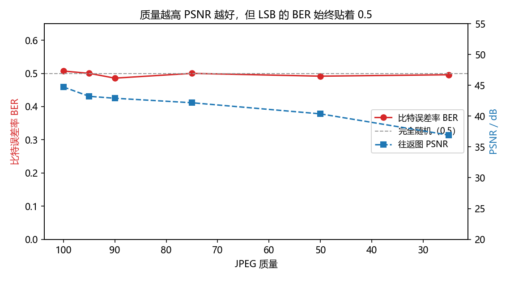
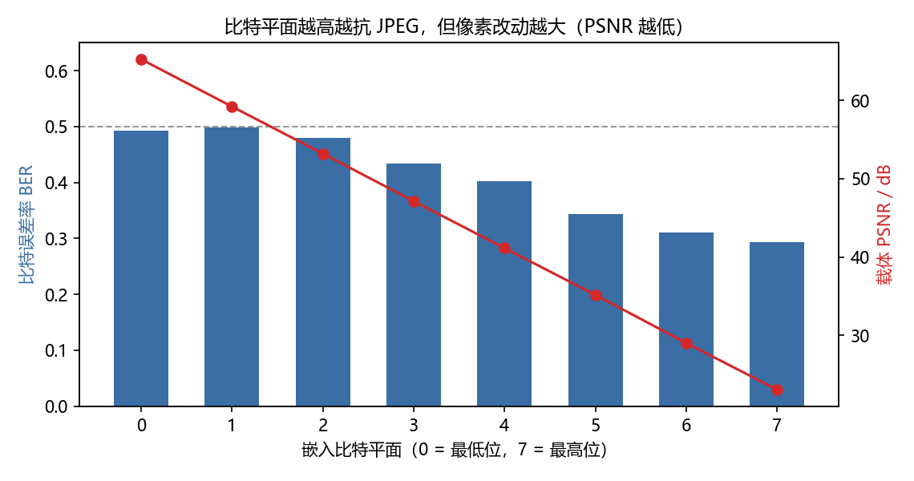
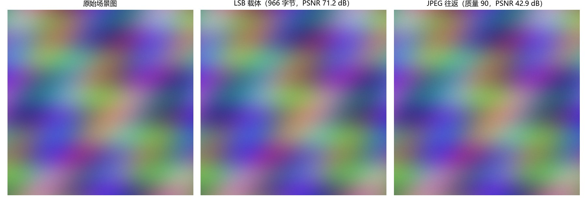
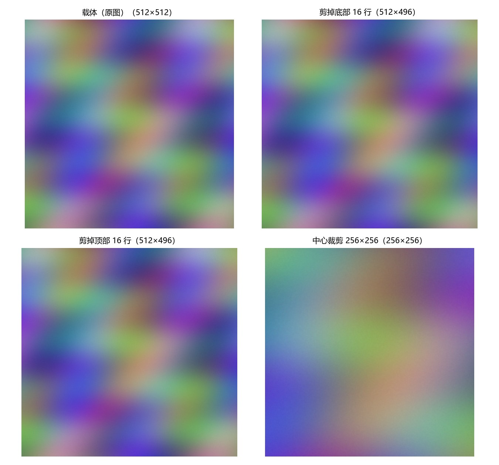

# 第 6 章　附加②③：JPEG 往返与剪裁下的 LSB 鲁棒性

> 负责人：B　　对应作业第 24、25 页　　状态：已完成（2026-11-25）
> 代码：`robustness.py`、`tools/jpeg_roundtrip.py`、`demo_robustness.py`、`tests/test_robustness.py`
> 数据与图：`outputs/B/results.json`、`outputs/B/*.png`（`outputs/` 已在 `.gitignore` 中排除）
> 前置：`bmp_lsb.py` 于任务 0 冻结，本章全程只调用 `BMP.open/embed/extract/positions/value` 与 `analyze`，未改动底座

## 6.1 结论速览

| 实验 | 做法 | 一句话结论 |
| --- | --- | --- |
| 附加② 有损压缩 | 24 位图嵌入 → 另存 JPEG → 再另存 24 位 BMP → 提取 | 质量 90、PSNR 42.9 dB（肉眼无差别）时，比特误差率 0.486，966 字节消息只有 7 个字节碰巧正确，**完全不可还原**；质量 25～100 全区间 BER 都在 0.49～0.53，抗 JPEG 能力约为 0 |
| 附加③ 剪裁 | 对载体做整行剪裁、左右剪裁、中心裁剪后再提取 | 剪裁**必然**破坏消息：整行剪裁会把消息整体移位（剪 1 行移 192 字节），左右剪裁直接打乱字节对齐；只有"剪掉的正好是消息之后的部分"时消息才完整——这解释了为什么"剪掉顶部 16 行"消息仍在，而"剪掉底部 16 行"消息全毁 |

两条结论都不是实现瑕疵：LSB 把信息放在 DCT 量化误差与舍入误差之下，任何有损重编码都会把它抹掉；剪裁则改变了像素与比特的对应关系。**要抗这两种攻击，必须改变嵌入方式（冗余、纠错、换域），而不是调整 LSB 的参数。**

## 6.2 实验环境、素材与指标

### 6.2.1 环境与"不得使用图像库"的边界

作业要求"不得使用现有图片处理函数库或工具包"。本章的处理是：

- 隐写与提取仍然只用 `bmp_lsb.py` 的手写 BMP 解析，**没有引入任何图像库**；
- JPEG 这一步按作业原文应当在**画图**里手工完成。为了让 6 个质量、8 个比特平面、8 种剪裁可重复，另写了 `tools/jpeg_roundtrip.py`：用标准库实现基线 JPEG 的编码与解码（DCT、量化、Z 字形、标准霍夫曼表、4:2:0 / 4:4:4），它只在实验脚本里被调用，不进入隐写路径；
- 该工具的正确性用两条外部证据校验（6.3.2 节）：与本机 Pillow 解码逐像素比对（PSNR 50～52 dB，常见差 1～2 级，低质量边缘块最大差 29 级），以及用 Windows 系统自带的 GDI+（画图同源的系统编解码器）做同样的往返，结论一致。

### 6.2.2 测试图

| 图 | 尺寸/位深 | 容量 | 用途 |
| --- | --- | --- | --- |
| 合成场景图（`demo_robustness.py` 生成，种子 2026） | 512×512 / 24 位 | 98 304 B | 主实验图 |
| `samples/color256.bmp` | 256×256 / 24 位 | 24 576 B | 换图对照 |

教师素材目录不在本机（`tools/bmp_probe.py` 会报"未找到素材目录"），因此主实验图用固定种子生成：低频彩色渐变（模拟平滑场景）+ 每像素 ±3 的颗粒噪声。颗粒的作用是让全图 LSB 接近随机——否则大片平滑区域的 LSB 恒为 0，统计会失真。生成脚本在 `demo_robustness.py` 的 `make_scene()`，任何人重跑都得到同一张图。

载荷为 966 字节 UTF-8 文本（`demo_robustness.py` 中的 `PAYLOAD`），约为容量的 1%。选 1% 而不是满容量，是为了让剪裁实验能看出"消息只占样本流开头一小段"这一关键事实；6.4 节的质量实验与载荷大小无关。

### 6.2.3 指标

| 指标 | 定义 |
| --- | --- |
| BER | 逐比特比对原消息与提取结果，不同比特数 ÷ 比对比特数。0 为完好，0.5 为完全随机 |
| 正确字节 | 提取结果中与原消息逐字节相同的个数 |
| 最长正确前缀 | 从第 1 字节起连续正确的字节数 |
| PSNR | `10·log10(255²/MSE)`，只衡量"看起来像不像"，与本程序能否提取无关 |

## 6.3 附加②：操作方法

### 6.3.1 手工路径（画图）

1. `python demo_robustness.py` 生成 `outputs/B/carrier_hidden.bmp`（已嵌入 966 字节）；
2. 画图打开 `carrier_hidden.bmp`，**另存为** JPEG（保持画图默认质量），得到 `carrier.jpg`；
3. 关闭画图，重新打开 `carrier.jpg`，**另存为** 24 位 BMP，得到 `carrier_back.bmp`；
4. 按原长度提取：

   ```bat
   python -X utf8 -c "from bmp_lsb import BMP; raw = BMP.open(r'carrier_back.bmp').extract(966); print(raw[:24].hex(' '))"
   ```

   因为 `main.py extract` 会按 UTF-8 解码并直接报错，这里用 24 字节十六进制观察"提取到了什么"；
5. 与原文比较，记录 BER。逐张截图对应报告图 6-1 与 6-2。

### 6.3.2 自动路径（本仓库工具）

```bash
python -X utf8 tools/jpeg_roundtrip.py --input outputs/B/carrier_hidden.bmp \
    --jpeg outputs/B/jpeg_q90_420.jpg --bmp outputs/B/jpeg_back_q90.bmp --quality 90
python -X utf8 demo_robustness.py        # 一次跑完 6 个质量 + 8 个比特平面 + 8 种剪裁
```

编码器要点（`tools/jpeg_roundtrip.py`）：RGB→YCbCr（JFIF 全范围）、4:2:0 用 2×2 盒式平均、8×8 浮点 DCT、IJG 质量缩放的量化表、标准霍夫曼表、0xFF 字节填充；解码端支持 4:4:4/4:2:2/4:2:0 基线流与重启标记，遇到渐进式直接报错而不是静默给错数据。

**外部校验（2026-11-25 实跑）**

| 校验 | 结果 |
| --- | --- |
| 本工具编码 → Pillow 解码 vs 本工具解码（512×512，质量 90/4:2:0） | PSNR 51.46 dB，最大差 2 级 |
| Pillow 编码 → 本工具解码 vs Pillow 解码（3 组质量/采样） | PSNR 51.4～52.0 dB，最大差 ≤ 16 级（4:2:0 边缘块） |
| 系统 GDI+（画图同源）质量 90 往返 → 提取 | **BER 0.4994**，正确字节 3/966，PSNR 42.40 dB |
| 本工具解码 vs 系统解码同一 JPEG | PSNR 51.40 dB，最大差 3 级 |

最后两行是关键：换成真实系统编码器，BER 仍是 0.5 量级，说明结论不依赖本工具的 JPEG 实现。

## 6.4 附加②：结果

### 6.4.1 质量阶梯（512×512，4:2:0，载荷 966 B）

| JPEG 质量 | JPEG 体积 | 往返图 PSNR | BER | 正确字节 | 完整提取 |
| --- | --- | --- | --- | --- | --- |
| 100 | 135 KiB | 44.72 dB | 0.5071 | 6/966 | 否 |
| 95 | 41 KiB | 43.21 dB | 0.5003 | 4/966 | 否 |
| 90 | 24 KiB | 42.89 dB | 0.4858 | 7/966 | 否 |
| 75 | 11 KiB | 42.16 dB | 0.5001 | 5/966 | 否 |
| 50 | 8 KiB | 40.36 dB | 0.4917 | 2/966 | 否 |
| 25 | 6 KiB | 36.91 dB | 0.4960 | 4/966 | 否 |

> 表 6-1　JPEG 质量对提取结果的影响（`outputs/B/results.json` 的 `quality`）
> 注：质量 90 时 JPEG 仅为原 BMP（786 486 B）的 3.0%。

### 6.4.2 对照实验

| 实验 | 结果 |
| --- | --- |
| 质量 90 但 4:4:4（不做色度下采样） | JPEG 34 843 B，BER 0.4934，不可还原 |
| `samples/color256.bmp`（彩虹渐变），质量 90 | PSNR 19.50 dB，BER 0.5126，不可还原 |
| 字节复制的 BMP（C1 原图对照，不经 JPEG） | BER 0，完整还原（说明破坏来自 JPEG，不是工具链） |

4:4:4 这一行很重要：它排除了"色度下采样是唯一原因"的解释——只要还做 DCT 量化，LSB 就活不下来。

### 6.4.3 比特平面阶梯（质量 90）

| 嵌入平面 | BER | 完整提取 | 载体 PSNR | 最大像素误差 |
| --- | --- | --- | --- | --- |
| 0（LSB） | 0.4920 | 否 | 65.25 dB | 1 |
| 1 | 0.4988 | 否 | 59.20 dB | 2 |
| 2 | 0.4793 | 否 | 53.20 dB | 4 |
| 3 | 0.4331 | 否 | 47.12 dB | 8 |
| 4 | 0.4019 | 否 | 41.13 dB | 16 |
| 5 | 0.3437 | 否 | 35.15 dB | 32 |
| 6 | 0.3100 | 否 | 29.01 dB | 64 |
| 7 | 0.2928 | 否 | 23.06 dB | 128 |

> 表 6-2　把消息写在不同比特平面后过质量 90 的 JPEG（256×256 图，`jpeg_bit_plane_table`）



> 图 6-1　质量越高 PSNR 越好，BER 始终贴着 0.5（`outputs/B/jpeg_quality_curve.png`）



> 图 6-2　比特平面越高越抗 JPEG，代价是像素改动成倍增大（`outputs/B/bit_plane_ladder.png`）



> 图 6-3　原图、LSB 载体、JPEG 往返图肉眼几乎无差别（`outputs/B/jpeg_view.png`）

## 6.5 附加②：分析

### 6.5.1 为什么 LSB 在有损压缩后必然失效

JPEG 编码对每个 8×8 块做 DCT，把系数除以量化步长后取整，量化步长由质量决定。以质量 90 为例，亮度量化表的最小步长为 1、常用中频为 2～6、高频可达 10 以上；色度表更大，且 4:2:0 先把 2×2 像素的色度取平均。

设原像素为 $x$，解码重建为 $\hat x$。即使系数量化只差 1，逆变换后每个像素的误差也在 ±1～±3 级；实测往返图最大误差 8 级、MSE 3.34（PSNR 42.9 dB）。LSB 承载的信息是 ±1 级的差别，而重建误差比它大一个数量级，于是"LSB 被正确保留"只剩下"像素误差恰为 0 且奇偶不变"这一种情况，概率约为 1/2。

这就是表 6-1 中 BER 稳定在 0.5 附近的原因。它和"压缩质量好不好"没有关系：质量 100 时量化步长全为 1，但 DCT/IDCT 的浮点舍入仍然存在，BER 依旧 0.5071。

### 6.5.2 PSNR 高不等于消息还在

图 6-1 把两条曲线画在一起：质量从 25 提到 100，PSNR 从 36.9 dB 升到 44.7 dB（主观上从"略有块效应"到"看不出差别"），BER 却一直在 0.5 上下抖动。原因是两个指标测的不是同一件事：

- PSNR 是**像素级平均误差**，允许误差均匀分布在所有像素上；
- 提取要求**每个承载比特的像素都精确到 1 级**。966 字节 = 7728 个比特，只要错 1 个比特，对应的字节就废了。

即使单比特存活率高达 99%，7728 个比特全对的概率也只有 $0.99^{7728} \approx 10^{-34}$。这个数量级说明：LSB 方案对"每比特都正确"的要求，在有任何随机误差的信道里都不成立。这也解释了为什么"正确字节 7/966"——那是 966 个字节里碰巧 8 个比特全对的少数。

### 6.5.3 色度下采样不是唯一原因

常见的误解是"JPEG 破坏 LSB 是因为色度 4:2:0"。6.4.2 节的 4:4:4 对照（BER 0.4934）否定了这一点：不做下采样，量化与舍入照样把 LSB 抹平。4:2:0 只是让色度通道的误差更大，不是必要条件。

### 6.5.4 比特平面：用可见失真换鲁棒性

表 6-2 显示，把消息放到更高的比特平面，BER 单调下降到 0.29（平面 7），但载体 PSNR 从 65.25 dB 掉到 23.06 dB，最大像素误差达到 128 级——图 6-2 中这已经是肉眼可见的"马赛克"。而且即使平面 7 也没有做到完整提取：任何一次 ±1 的越界翻转都会毁掉一个字节。这说明"提高比特平面"不是可行的改进路线，除非同时加入纠错码。

### 6.5.5 小结

| 问题 | 回答 |
| --- | --- |
| LSB 能抗 JPEG 吗 | 不能。质量 25～100、4:2:0 与 4:4:4、本工具与系统编码器，BER 全部在 0.49～0.53 |
| 质量越高是不是越安全 | 不是。PSNR 提高到 44.7 dB，BER 仍是 0.5071 |
| 换比特平面能救吗 | 只能把 BER 降到 0.29，代价是 PSNR 降到 23 dB，仍不可用 |
| 实际影响 | 任何"微信/QQ 发图、网盘压缩、截图另存"链条都会让 LSB 载体失效；载体必须以 BMP/PNG 等无损格式原样传输 |

## 6.6 附加③：操作方法

剪裁在图像坐标中定义：保留矩形 `(left, top, width, height)`，其余剪掉，再另存为 BMP。因为冻结的解析器只接受**宽度为 4 的倍数**的 BMP（`docs/接口约定.md`），裁剪宽度只取 4 的倍数；这不影响结论，但要在报告里如实写明这条实验约束。

实验用 `robustness.crop()` 完成，它按行搬运像素、重建文件头（`bfSize`、宽、高、`biSizeImage`），产物是正高度的标准 BMP，可直接 `BMP.open`。手工版就是在画图里选中区域→裁剪→另存为 BMP，效果等价。

8 种剪裁（对同一张已嵌入 966 字节的 512×512 载体）：

| 编号 | 剪裁方式 | 保留矩形 |
| --- | --- | --- |
| C1 | 原图对照 | (0, 0, 512, 512) |
| C2 | 剪掉底部 16 行 | (0, 0, 512, 496) |
| C3 | 剪掉顶部 16 行 | (0, 16, 512, 496) |
| C4 | 剪掉底部 1 行 | (0, 0, 512, 511) |
| C5 | 剪掉左侧 4 列 | (4, 0, 508, 512) |
| C6 | 剪掉右侧 4 列 | (0, 0, 508, 512) |
| C7 | 中心裁剪 256×256 | (128, 128, 256, 256) |
| C8 | 只留底部 16 行 | (0, 496, 512, 16) |

### 6.6.1 样本流模型

这是理解全部剪裁结果的关键。`BMP.positions()` 的遍历顺序是：

1. **按文件里的行顺序**，从第 1 行像素开始；
2. 正高度 BMP 的第 1 行是**图像最底下一行**（自下而上存储）；
3. 行内从左到右，24 位图每个像素按 **B、G、R** 三个样本；
4. 行末填充字节不参与。

于是嵌入的比特流从"图像左下角"开始向右、向上铺开。设每行样本数 $S = 3W$，剪掉底部 $b$ 行 = 从流头删掉 $bS$ 个比特；剪掉顶部 $t$ 行 = 从流尾删掉 $tS$ 个比特。字节能否存活还取决于对齐：只有当 $bS$ 是 8 的倍数时，剩下的比特才仍按原字节边界分组，即

$$3W \bmod 8 = 0 \iff W \bmod 8 = 0$$

512 满足这个条件（$3\times512=1536=192\times8$），所以"整行剪裁"仍是字节对齐的，消息只是**整体平移**了 $192b$ 字节；4、12 这类宽度不满足，剪 1 行就把所有字节拆散。

## 6.7 附加③：结果

| 剪裁 | 剪后容量 | 流头位移 | BER | 最长正确前缀 | 偏移处可恢复 | 完整提取 |
| --- | --- | --- | --- | --- | --- | --- |
| C1 原图 | 98 304 B | 0 | 0.0000 | 966/966 | 966/966 | 是 |
| C2 剪掉底部 16 行 | 95 232 B | 3 072 B | 0.4966 | 0 | 0/966 | 否 |
| C3 剪掉顶部 16 行 | 95 232 B | 0 | 0.0000 | 966/966 | 966/966 | **是** |
| C4 剪掉底部 1 行 | 98 112 B | 192 B | 0.4519 | 0 | 774/966 | 否 |
| C5 剪掉左侧 4 列 | 97 536 B | —（不对齐） | 0.4577 | 0 | — | 否 |
| C6 剪掉右侧 4 列 | 97 536 B | —（不对齐） | 0.3568 | 190/966 | — | 否 |
| C7 中心 256×256 | 24 576 B | —（不对齐） | 0.5089 | 0 | — | 否 |
| C8 只留底部 16 行 | 3 072 B | 0 | 0.0000 | 966/966 | 966/966 | 是 |

> 表 6-3　剪裁后的提取结果（`outputs/B/results.json` 的 `crops`）
> "偏移处可恢复"由样本流模型预测，8 个用例中 5 个可预测的用例**预测值与实测值完全一致**。

| 宽度 W | 每行样本数 3W | 是 8 的倍数 | 剪 1 行位移 | 可恢复字节 | BER |
| --- | --- | --- | --- | --- | --- |
| 4 | 12 | 否 | 12 样本 | 0/4 | 0.4688 |
| 8 | 24 | 是 | 24 样本（3 B） | 1/4 | 0.4688 |
| 12 | 36 | 否 | 36 样本 | 0/4 | 0.5625 |

> 表 6-4　宽度决定整行剪裁后是否还能保持字节对齐（24 位小图，消息 `ABCD`）



> 图 6-4　原图与三种剪裁（`outputs/B/crop_view.png`）

## 6.8 附加③：分析

### 6.8.1 顶部与底部不对称

表 6-3 里最反直觉的是 C2 与 C3：同样剪 16 行，剪**底部**消息全毁，剪**顶部**消息完好。原因是 BMP 自下而上存储，样本流从图像底部开始，消息占的是流开头的 7728 个比特：

- 剪底部 → 删掉流头 → 消息开头被删；
- 剪顶部 → 删掉流尾 → 消息整段还在，只是图像的其余部分变短了。

这不是"算法偏心"，而是存储方向造成的方向不对称。只要把第 2 章的"扫描方向"结论（正高度 BMP 自下而上）与本章的样本流模型连起来，就能预测任意矩形剪裁的结果。

### 6.8.2 整行剪裁：消息整体平移

C4 是最能说明"剪裁不是删数据、而是改对应关系"的一例：只剪 1 行（192 字节），消息的前 192 字节被删掉，剩下的 774 字节**内容没变，只是提前了 192 字节**。所以在正确的偏移上能恢复 774/966 字节（模型预测 774，实测 774）。C2 的位移是 3072 字节，已超过消息长度 966，于是全部丢失。

一般地，整行剪裁后可恢复的字节数为 `max(0, L − 192b)`，其中 `L` 为消息长度、`b` 为剪掉的行数。这个公式对任何 `W` 为 8 倍数的图都成立，只需把 192 换成 `3W/8`。

### 6.8.3 左右剪裁：字节被拆散

C5、C6 只剪 4 列，删除的数据不到 1%，却几乎毁掉全部消息。原因不是"删得多"，而是**每行的保留段都整体左移了 12 个样本**：第 1 行剩下 1524 个样本，第 2 行从原来第 1548 个样本接着排，比特流被"错位拼接"，此后每个字节都由两行不相邻的比特拼成。C6 还保留 190 字节前缀，是因为消息的前 190 字节正好都落在第 1 行内（$1524/8=190.5$），而消息共 966 字节、要跨 6 行，后面 5 行全部错位。

中心裁剪 C7 同时犯两个错误：位移 + 错位，BER 0.509，与随机无异。

### 6.8.4 剪裁后的容量变化

剪裁会改变容量（表 6-3 第 2 列），但提取时程序按**新图**从头读，不会知道原图被剪过。"容量变小"从来不是问题，"位置变了"才是。这也提示：如果一定要在剪裁后恢复，必须把同步信息（例如长度、块号、同步码）也冗余地嵌进去，而 LSB 连"位置"都保不住，更谈不上保同步信息。

### 6.8.5 小结

| 问题 | 回答 |
| --- | --- |
| LSB 能抗剪裁吗 | 不能。除"剪掉的恰好是消息之后的部分"外，任何剪裁都会破坏消息；左右剪裁删 1% 的像素就足以全毁 |
| 为什么顶部剪裁没事 | 消息在样本流开头（图像底部），剪顶部只动流尾 |
| 为什么左右剪裁这么致命 | 每行保留段错位，比特流被按行重新拼接，字节边界全部错开 |
| 与宽度的关系 | 整行剪裁保不保对齐，取决于 $3W \bmod 8$；$W$ 为 8 的倍数才保 |

## 6.9 改进方向

本章证明了"普通 LSB 不抗 JPEG、不抗剪裁"，下面几条是报告中可以展开、但不要求实现的改进：

1. **冗余与纠错**：同一比特重复 $k$ 次取多数，或用 RS/BCH 纠错码。它把容量降到 $1/k$，换来可纠正的比特错误；对 6.4 的 BER≈0.5 无效（错得太多，纠错码也救不回），但能对付"少量比特翻转"的场景。
2. **块级重复 + 块号**：把消息切成若干块，每块带块号重复嵌入整个图。剪裁后只要有一块完整存活，就能恢复该块；这需要额外的同步机制。
3. **换域嵌入**：DCT 中低频系数、DWT 低频子带、扩频水印天生抗压缩，代价是容量小、计算复杂，且不再是"每个样本 1 比特"的简单 LSB。
4. **格式约束**：对 LSB 最现实的建议是"载体必须以无损格式传输"——本章的 BER 数据可以直接作为这条建议的证据。

## 6.10 复现与产物

```bash
python -X utf8 -m unittest tests.test_robustness -v   # 24 项
python -X utf8 -m unittest discover -s tests          # 全量 55 项（6 项教师素材测试自动跳过）
python -X utf8 demo_robustness.py                     # 生成全部表格数据与图
python -X utf8 tools/jpeg_roundtrip.py --input outputs/B/carrier_hidden.bmp \
    --jpeg outputs/B/jpeg_q90_420.jpg --bmp outputs/B/jpeg_back_q90.bmp --quality 90
```

| 产物 | 内容 |
| --- | --- |
| `outputs/B/carrier_scene.bmp` | 原始测试图（512×512） |
| `outputs/B/carrier_hidden.bmp` | 嵌入 966 字节的载体 |
| `outputs/B/jpeg_q90_420.jpg` / `jpeg_back_q90.bmp` | 自动路径的质量 90 往返产物 |
| `outputs/B/paint_q90.jpg` / `paint_back.bmp` | 系统 GDI+（画图同源）质量 90 的往返产物 |
| `outputs/B/jpeg_quality_curve.png` | 图 6-1 |
| `outputs/B/bit_plane_ladder.png` | 图 6-2 |
| `outputs/B/jpeg_view.png` | 图 6-3 |
| `outputs/B/crop_view.png` | 图 6-4 |
| `outputs/B/results.json` | 本章全部表格的原始数据 |

## 6.11 与接口约定的关系

| 约定 | 本章做法 |
| --- | --- |
| `bmp_lsb.py` 冻结 | 未修改；`robustness.py` 只 `from bmp_lsb import BMP, BMPError` |
| 逐样本遍历用 `positions()` / `value()` | 位平面嵌入、BER 比对均如此；8 位图按调色板反查索引 |
| 不自己算像素偏移 | 嵌入/提取只用 `positions()`/`value()`；剪裁按行复制原始字节，用公开字段 `offset`/`stride`/`height` 定位行，不解析调色板或像素语义 |
| 剪裁宽度须为 4 的倍数 | `crop()` 显式拒绝其它宽度，理由见 6.6 节 |
| 新增能力新建文件 | 新增 `robustness.py`、`tools/jpeg_roundtrip.py`、`demo_robustness.py`、`tests/test_robustness.py`，未动 `main.py`、`gui.py` |
